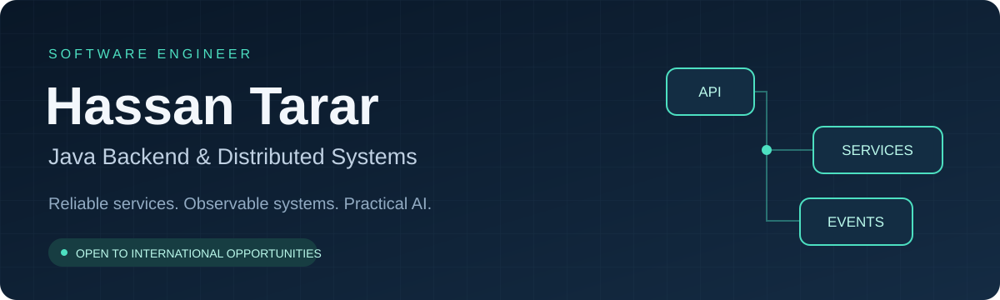

  

  <a href="#about">About</a> ·
  <a href="#selected-projects">Selected projects</a> ·
  <a href="#technical-toolkit">Technical toolkit</a> ·
  <a href="#opportunities">Opportunities</a>

  <a href="https://hassantarar.com"><strong>Visit my portfolio ↗</strong></a>
  &nbsp; · &nbsp;
  <a href="https://pk.linkedin.com/in/hassan-ijaz-166366168"><strong>Connect on LinkedIn ↗</strong></a>
  &nbsp; · &nbsp;
  <a href="https://github.com/HassanTarar1?tab=repositories"><strong>Explore my code ↗</strong></a>

---

## About

I'm **Hassan Tarar (Hassan Ijaz)**, a **Software Engineer with 4+ years of experience**, focused on **Java, Spring Boot, APIs, and distributed systems**.

I build backend applications with attention to performance, reliability, maintainability, and clear service boundaries. My interests span system integration, cloud infrastructure, search, and observability. I also explore practical uses of AI in engineering workflows.

**Based in Islamabad, Pakistan · Seeking international engineering opportunities, including roles with relocation and visa sponsorship.**

| Focus | What I work with |
| :--- | :--- |
| **Backend engineering** | Java, Spring Boot, REST APIs, GraphQL, microservices |
| **Data and integration** | PostgreSQL, MySQL, Elasticsearch, OpenSearch |
| **Production visibility** | New Relic, Prometheus, Grafana, Jaeger |
| **Product development** | Angular, React, TypeScript, AI-assisted workflows |

## Selected projects

### 01 / Production Issue Process Automation
**Java 21 · Spring Boot · Angular · Developer tooling**

A hackathon demonstration exploring the path from a runtime error to an assisted fix: log analysis, fix generation, GitHub pull requests, Slack notifications, and Playwright verification.

[**Explore the repository →**](https://github.com/HassanTarar1/Prod-Issue-Process-Automation-bob-Hackathon)

<strong>Explore the workflow and engineering focus</strong>

The project documentation describes a flight dashboard with deliberately introduced errors for demonstrating the repair workflow.

- **Problem:** Investigating recurring runtime errors involves several disconnected steps.
- **Approach:** Connect a Spring Boot backend and Angular dashboard with log analysis and development-tool integrations.
- **Review focus:** API boundaries, exception handling, external integrations, and the documented verification workflow.
- **Scope:** Hackathon demonstration; not a claim of a deployed autonomous production-repair service.

[Read the architecture and local setup](https://github.com/HassanTarar1/Prod-Issue-Process-Automation-bob-Hackathon#readme)

### 02 / AegisNet AI
**Java 21 · Spring Boot · Angular · Gemini · Kotlin**

A hackathon crisis-intelligence concept exploring how citizen reports, environmental signals, and AI-assisted analysis could support incident assessment and response coordination.

[**Explore the repository →**](https://github.com/HassanTarar1/AegisNet-AI---Google-AI-Hackathon-)

<strong>Explore the architecture and project scope</strong>

The documented design connects a command-center dashboard, a backend, and a mobile application.

- **Problem:** Crisis information can arrive from fragmented sources and needs contextual analysis.
- **Approach:** Explore agent workflows for classification, verification, correlation, and response recommendations.
- **Review focus:** The proposed service architecture, real-time updates, spatial data, and explainable agent traces.
- **Scope:** Hackathon concept/prototype with simulated response scenarios; not a validated emergency-response system.

[Read the architecture and local setup](https://github.com/HassanTarar1/AegisNet-AI---Google-AI-Hackathon-#readme)

## Technical toolkit

| Area | Technologies |
| :--- | :--- |
| **Languages** | Java · SQL · JavaScript · TypeScript · Kotlin |
| **Backend** | Spring Boot · Spring Framework · REST · GraphQL |
| **Frontend** | Angular · React · HTML · CSS |
| **Data and search** | PostgreSQL · MySQL · Elasticsearch · OpenSearch |
| **Cloud and delivery** | AWS · Docker · Linux · CI/CD · Git |
| **Observability** | New Relic · Prometheus · Grafana · Jaeger |

<strong>What I'm exploring next</strong>

- Java virtual threads and modern backend concurrency
- Event-driven architecture and distributed systems
- AI agents, Gemini APIs, and developer automation
- Cloud-native architecture and production observability

These are learning and exploration interests, separate from the core experience above.

## Opportunities

I'm interested in **Java Backend Engineer**, **Backend Software Engineer**, and **Software Engineer — Distributed Systems** roles.

I'm open to discussing **international opportunities with relocation and visa sponsorship**. I'd welcome conversations with teams working on backend platforms, APIs, integrations, and reliable services.

**Hiring or building a team?** [Connect with me on LinkedIn](https://pk.linkedin.com/in/hassan-ijaz-166366168) with the role, location, technical focus, and sponsorship availability.

  <a href="https://hassantarar.com">Portfolio</a> ·
  <a href="https://pk.linkedin.com/in/hassan-ijaz-166366168">LinkedIn</a> ·
  <a href="https://github.com/HassanTarar1?tab=repositories">Repositories</a>

